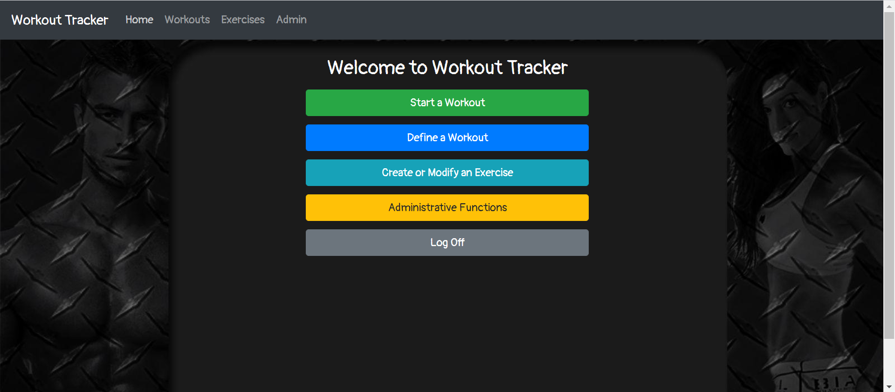
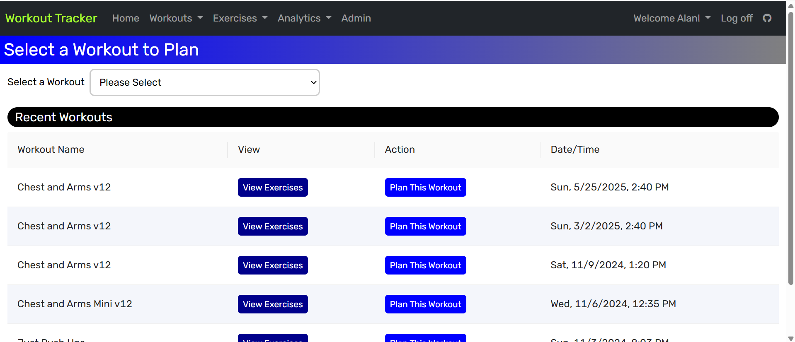
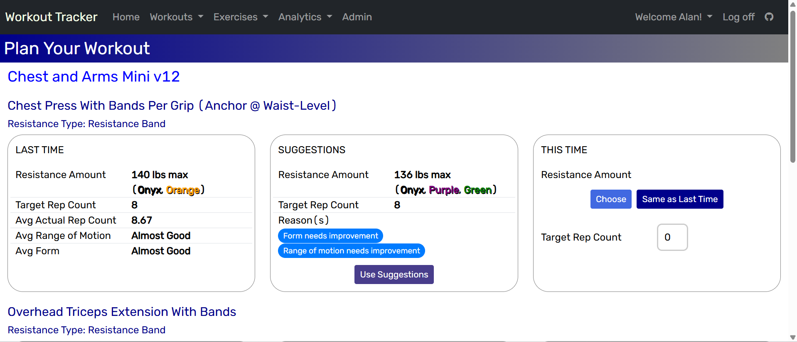
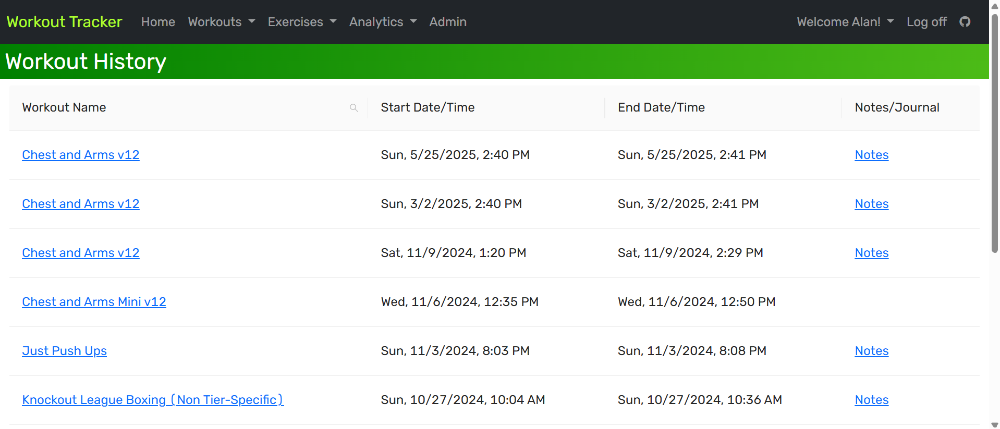
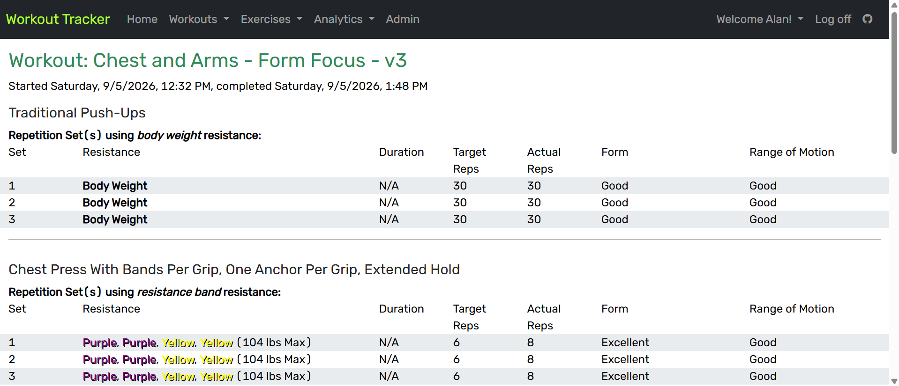
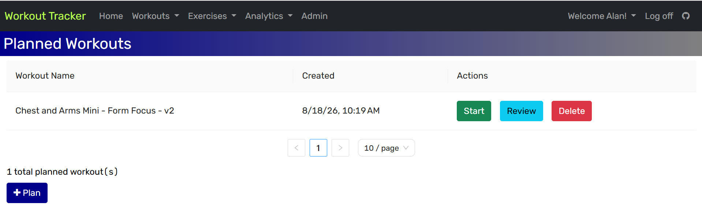
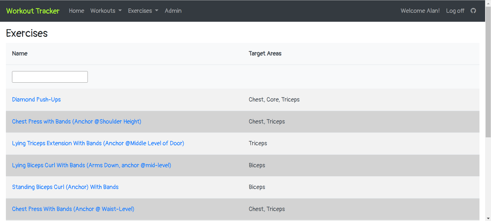
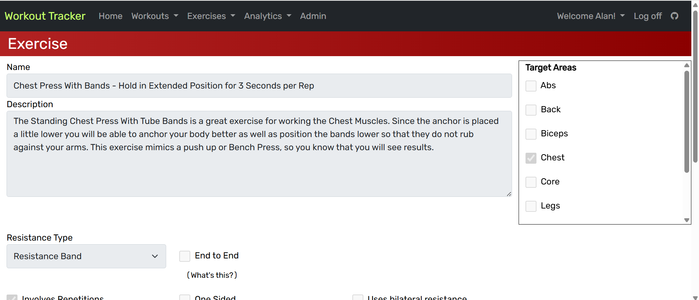
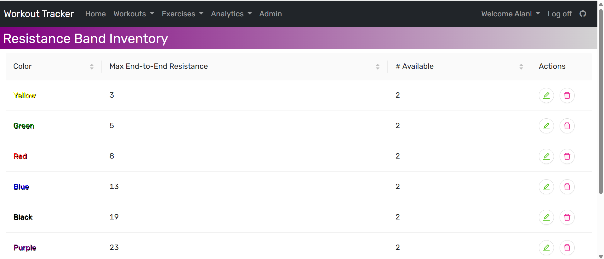
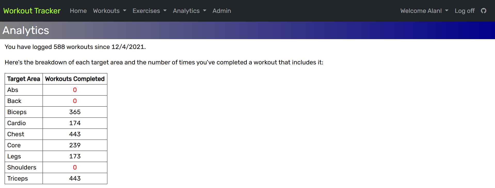

# Workout Tracker
A website for creating and tracking workouts. I wrote this to replicate and expand upon a pen and paper system I've been using for a few years. Currently intended for home use inside a private network.

<br /><br />

<br /><br />

<br /><br />

<br /><br />

<br /><br />

<br /><br />

<br /><br />

<br /><br />

<br /><br />

<br /><br />

<br /><br />

<br /><br />

<br /><br />

<br /><br />

## Configuring the JWT signing key

The API signs login tokens with a secret key that is **not** stored in the repository.
You must create your own before the API will start. Never commit it.

**1. Generate a random key** (any of these):

```bash
openssl rand -base64 64
```

```powershell
$b = New-Object byte[] 64
[Security.Cryptography.RandomNumberGenerator]::Create().GetBytes($b)
[Convert]::ToBase64String($b)
```

**2. Provide it to the API** (pick one):

- Local development (user-secrets, stored outside the repo):
  ```bash
  dotnet user-secrets set "Jwt:Key" "<your-generated-key>" --project API/WorkoutTracker.API
  ```
- Aspire AppHost: set the `jwt-key` parameter, either in the dashboard prompt or with
  ```bash
  dotnet user-secrets set "Parameters:jwt-key" "<your-generated-key>" --project API/WorkoutTracker.AppHost
  ```
- Docker Compose / production: set the `Jwt__Key` environment variable (double underscore). The compose output
  generated by the AppHost exposes it as `JWT_KEY` in its `.env` file, which you fill in before `docker compose up`.

Changing the key signs everyone out, which is expected. Use a different key for each environment.

## CORS

By default the API accepts **no** cross-origin browser requests. That is correct for every supported setup, because the
Angular dev server, the Aspire AppHost and the Docker nginx image all proxy `/api`, so the browser only ever talks to
the origin that served the page.

You only need CORS when the SPA and the API are served from different origins, for example two IIS sites. An origin is
scheme + host + port, so `http://myhost` and `http://myhost:5600` are different origins. List the SPA's origin(s) in the
API's `Cors:AllowedOrigins` setting, in `appsettings.Production.json` or as environment variables:

```json
"Cors": { "AllowedOrigins": [ "https://app.example.com" ] }
```

```text
Cors__AllowedOrigins__0=https://app.example.com
```

Entries must be bare origins (`scheme://host[:port]`, no path or trailing slash). A wildcard or malformed entry stops
the API at startup with an explanatory message.

## First-run setup

A new installation has no users, and the API will not create one for just anyone. While no user exists, the API
prints a **one-time setup code** to its console:

```text
Initial setup required. Setup code: 7K2M-QX9D-TH4B-6NWE
```

Find it wherever you can read the API's output (the terminal running `dotnet run`, the API's logs in the Aspire
dashboard, or `docker compose logs api`). Then open the app: it sends you to a setup page where you enter a name, an
email address, a password (at least 12 characters) and that code, which creates the first administrator. After that
the setup page and the code stop working, and only administrators can create more users.

- The code is only ever printed to the console, never written to the log file. If you restart the API before finishing,
  a new code is printed. Five wrong guesses also replace a generated code (a code you set yourself is locked out instead; see below).
- For automation, set `Setup__Code` (at least 16 characters) to use a code you choose instead of a generated one.

### On IIS (or anywhere the console is not visible)

IIS does not show the API console, so the generated code above would never be seen. Choose the code yourself instead and
put it in configuration as `Setup:Code`:

1. Generate a random value of at least 16 characters, for example `openssl rand -base64 24`, or in PowerShell:
   ```powershell
   $b = New-Object byte[] 24
   [Security.Cryptography.RandomNumberGenerator]::Create().GetBytes($b)
   [Convert]::ToBase64String($b)
   ```
2. Set it in `appsettings.Production.json` (gitignored) or as an environment variable (`Setup__Code`) on the app pool.
   Do not put it in the committed `appsettings.json`. Recycle the app pool so it is picked up.
3. Open the app, which sends you to the setup page, and enter that code along with the administrator details.
4. **Remove `Setup:Code` from configuration afterwards.** It stops working as soon as a user exists, but it becomes
   valid again if every user is ever deleted, so it should not stay around. If it is still set when the API starts and a
   user already exists, the API logs a warning to remind you.

Five wrong guesses in a row lock the setup endpoint for 15 minutes (the response is `429`), even for the correct code.
The configured code itself is never replaced, so once the lockout ends, or after an app pool recycle, it works again.

You can instead enable stdout logging in `web.config` (`stdoutLogEnabled="true"` with an existing `stdoutLogFile` folder)
to read a generated code, but that writes the code to a log file on disk, so a configured code is the better choice.

## Password reset

Passwords are reset with a one-time link, never with a code the API hands back to whoever asks. A reset link works once,
expires (60 minutes by default, `PasswordReset:TokenLifetimeMinutes`), and carries its token after a `#` so it is never sent
to a server or written to a log. Only a hash of the token is stored. Resetting a password also signs the user out everywhere.

There are two ways a user gets a link:

- **By email**, if the API can send email (`SMTP:Enabled` and the other `SMTP:*` settings, and `smtpEnabled` in the
  frontend's `config.json`). The user enters their address on the "forgot password" page. The page always says the same thing
  whether or not the address has an account, so it can't be used to find out who has one. The email's link is built from
  `FrontEndResetPasswordURL`, which must be the full address of the reset page, for example
  `https://app.example.com/user/reset-password`. The API refuses to start if it isn't an absolute `http(s)` URL.
- **From an administrator**, if there is no email: on a user's edit page, **Reset password** creates a link for the
  administrator to give to the person. It works once and expires.

Every new password, however it is set (first-administrator setup, a new user, changing it, or a reset), must be at least
12 characters. Existing passwords keep working until their owner next changes them.

The three anonymous endpoints involved (request, validate, reset) are limited per client IP, 10 requests per 15 minutes by
default (`PasswordReset:RateLimit`). Behind a reverse proxy the proxy has to pass the real client address on, or everyone
shares one limit: the bundled `nginx.conf.template` already sets `X-Forwarded-For`, and the compose deployment enables
forwarded headers on the API. Direct IIS hosting needs nothing extra.
