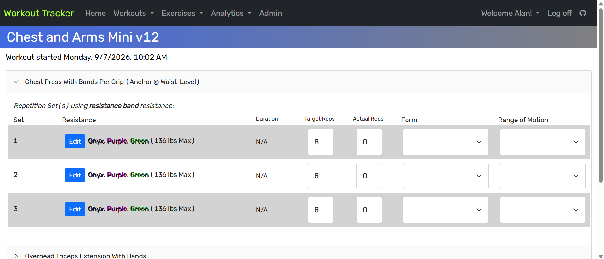
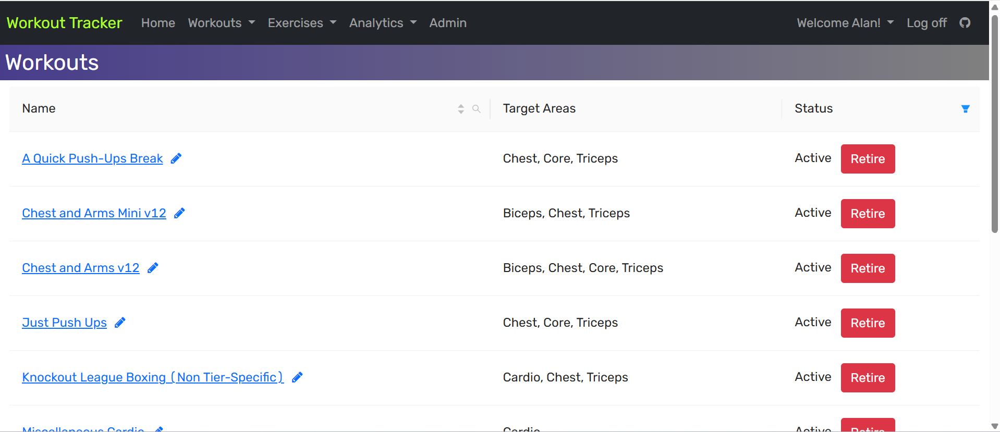
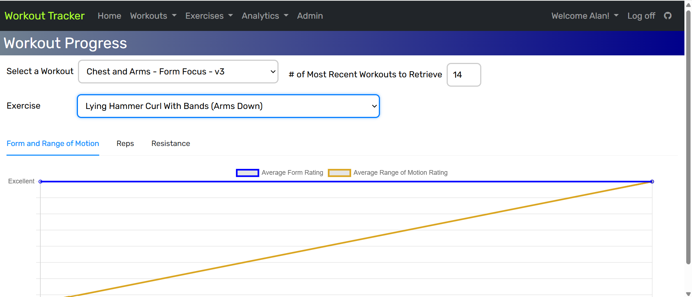
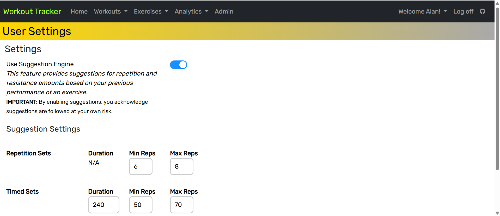

# Workout Tracker
A website for creating and tracking workouts. I wrote this to replicate and expand upon a pen and paper system I've been using for a few years. Currently intended for home use inside a private network.

<br /><br />

<br /><br />

<br /><br />

<br /><br />

<br /><br />

<br /><br />

<br /><br />

<br /><br />

<br /><br />

<br /><br />

<br /><br />

<br /><br />

<br /><br />

<br /><br />

## Configuring the JWT signing key

The API signs login tokens with a secret key that is **not** stored in the repository.
You must create your own before the API will start. Never commit it.

**1. Generate a random key** (any of these):

```bash
openssl rand -base64 64
```

```powershell
$b = New-Object byte[] 64
[Security.Cryptography.RandomNumberGenerator]::Create().GetBytes($b)
[Convert]::ToBase64String($b)
```

**2. Provide it to the API** (pick one):

- Local development (user-secrets, stored outside the repo):
  ```bash
  dotnet user-secrets set "Jwt:Key" "<your-generated-key>" --project API/WorkoutTracker.API
  ```
- Aspire AppHost: set the `jwt-key` parameter, either in the dashboard prompt or with
  ```bash
  dotnet user-secrets set "Parameters:jwt-key" "<your-generated-key>" --project API/WorkoutTracker.AppHost
  ```
- Docker Compose / production: set the `Jwt__Key` environment variable (double underscore). The compose output
  generated by the AppHost exposes it as `JWT_KEY` in its `.env` file, which you fill in before `docker compose up`.

Changing the key signs everyone out, which is expected. Use a different key for each environment.

## CORS

By default the API accepts **no** cross-origin browser requests. That is correct for every supported setup, because the
Angular dev server, the Aspire AppHost and the Docker nginx image all proxy `/api`, so the browser only ever talks to
the origin that served the page.

You only need CORS when the SPA and the API are served from different origins, for example two IIS sites. An origin is
scheme + host + port, so `http://myhost` and `http://myhost:5600` are different origins. List the SPA's origin(s) in the
API's `Cors:AllowedOrigins` setting, in `appsettings.Production.json` or as environment variables:

```json
"Cors": { "AllowedOrigins": [ "https://app.example.com" ] }
```

```text
Cors__AllowedOrigins__0=https://app.example.com
```

Entries must be bare origins (`scheme://host[:port]`, no path or trailing slash). A wildcard or malformed entry stops
the API at startup with an explanatory message.
