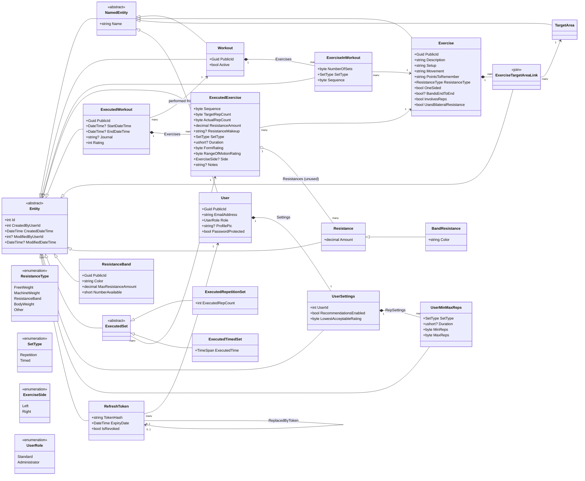

# Domain Model

Generated from `API/WorkoutTracker.Domain` and the EF Core setup in `API/WorkoutTracker.Data` (October 2026). Renders in GitHub, VS Code (Mermaid preview), and most Markdown viewers.

Every entity inherits `Entity` (`Id`, `CreatedByUserId`, `CreatedDateTime`, `ModifiedByUserId`, `ModifiedDateTime`). `NamedEntity` adds `Name`. Those audit columns and the inheritance are omitted from the diagram's attribute lists, and `Entity`/`NamedEntity` appear only as the base classes.

## Notes

- **Template vs. history.** `Workout` / `ExerciseInWorkout` are the reusable plan. `ExecutedWorkout` / `ExecutedExercise` are a recorded occurrence of it. `ExecutedExercise` copies its own `Sequence`, `SetType`, and `TargetRepCount` rather than pointing at `ExerciseInWorkout`.
- **Exercise ↔ TargetArea** is many-to-many through the explicit `ExerciseTargetAreaLink` entity. `TargetArea` has no navigation back to the link.
- **Public IDs.** `Workout`, `ExecutedWorkout`, `Exercise`, `ResistanceBand`, and `User` implement `IPublicEntity` (`Guid PublicId`), which is what the API exposes.
- **`CreatedByUserId` / `ModifiedByUserId`** are plain ints on every entity, not mapped navigations to `User`, so they are not drawn as relationships.
- **`UserSettings.UserId`** is the FK, but `User` owns the `Settings` navigation. `UserSettings` is not a `DbSet` of its own, so it is reached through `Users`.

## Defined but not (fully) in use

- `ExecutedExercise.Resistances` → `Resistance` is marked `//TODO: Remove! Unused.` in code. `Resistance` and `BandResistance` are otherwise orphaned from the main flow (`BandResistance` has no `DbSet`).
- `ExecutedSet`, `ExecutedRepetitionSet`, `ExecutedTimedSet` are mapped (`DbSet<ExecutedSet>`), but the app's current model keeps rep/time data directly on `ExecutedExercise`.
- `Set`, `RepetitionSet`, `TimedSet`, `SuperSet` exist in `Domain/Sets` but are not mapped (`DbSet<Set>` is commented out) and are omitted from the diagram. `SuperSet` is an empty TODO stub.
- `UserGoal` enum is defined but its uses in `UserSettings` / `UserMinMaxReps` are commented out.
